# 🌟 NOVA AI — ALEXA-NEXT 2.0
### Autonomous Multimodal Web Assistant, Life Guardian & IoT Companion
**Built for the [Build, Ship, Shape: Amazon Developer Hackathon](https://amazonappdev2026.devpost.com/) — Track: Alexa+ (Agentic Experiences & Self-Hosted MCP)**

[](https://amazonappdev2026.devpost.com/)
[](https://amazonappdev2026.devpost.com/)
[](https://modelcontextprotocol.io/)
[](https://aistudio.google.com/)
[](https://www.python.org/)
[](https://fastapi.tiangolo.com/)
[](https://www.sqlite.org/)
[](https://tailwindcss.com/)
[]()
[](LICENSE)

---

## 🏆 Amazon Developer Hackathon Alignment: Alexa+ Track

> **Event:** [Build, Ship, Shape: Amazon Developer Hackathon](https://amazonappdev2026.devpost.com/) (Hosted by Amazon Developer on Devpost)  
> **Challenge Track:** **Alexa+** (*"Build agentic experiences, self-hosted MCP (Model Context Protocol) servers, or Agent Skills using the open standards powering Alexa+"*)  
> **Target Amazon Ecosystem:** Amazon Echo, Echo Show (Multimodal Screen Experience), Fire TV, and Fire OS / Android Tablets.

### 🎯 How NOVA Answers Amazon's Hackathon Challenge
Amazon selected the **Model Context Protocol (MCP)** as an open standard for third-party services and agent skills to plug into Alexa+. Because official preview developer toolkits are restricted to select enterprise partners, Amazon challenged hackathon developers to:
1. **Build a Self-Hosted MCP Server** exposing tools over Streamable HTTP transport.
2. **Simulate the Alexa+ Experience** using an agentic web application and companion dashboard.

**NOVA AI directly fulfills this challenge:**
* **Self-Hosted FastMCP Server:** Implements the official MCP specification (2025-11-25) over **Streamable HTTP** at `http://127.0.0.1:8000/mcp`, exposing tools (`list_devices`, `set_device_state`, `get_energy_summary`, `get_saving_tips`).
* **Simulated Alexa+ Multimodal Companion:** Designed for screen-equipped Amazon devices like the **Echo Show** and **Fire Tablets**, pairing an authentic **8-State Animated Alexa Eye** with speech recognition/neural synthesis, interactive mission plan review cards, Leaflet GPS maps, and real-time Trust Center auditing.
* **Agentic Autonomous Mission Mode:** Moves beyond shallow, single-turn voice skills into multi-step goal formulation, human-in-the-loop review, bounded execution, and verified tool postconditions.
* **Fire OS & Ambient Android Companion:** Via [`mobile_android/NovaForegroundService.kt`](file:///c:/Users/APURVA/OneDrive/Documents/Desktop/Alexa/mobile_android), NOVA provides ambient GPS tracking, screen time supervision, and emergency SOS dispatch for Fire OS and Android devices.

---

## 📌 Project Overview & Vision

**NOVA AI (Alexa-Next 2.0)** transforms smart voice assistants from passive command-responders into an **autonomous, proactive, and multimodal personal agent**.

Traditional voice assistants suffer from fundamental limitations:
1. **Shallow Single-Turn Execution:** They answer trivia or set timers, but cannot plan, decompose, or complete complex multi-step objectives.
2. **Hallucinated & Unaudited Tool Calls:** Users have zero visibility into what tools are invoked, whether actions succeeded, or how secrets are handled.
3. **Ephemeral Context & Amnesia:** They forget user routines, critical preferences, and long-term commitments between sessions.
4. **Lack of Proactive Protection:** They wait to be addressed rather than detecting schedule congestion, approaching deadlines, or physical emergencies.

**NOVA AI solves this** by pairing **Google Gemini 3.8 Flash (with Multi-LLM Fallback to OpenAI & Groq Llama 3.3)** with:
* 🚀 **Autonomous Mission Mode:** Multi-step goal formulation, human-in-the-loop review, and verified execution.
* 🔌 **Model Context Protocol (FastMCP 2025-11-25):** Live streamable HTTP transport for agent-to-agent interoperability.
* 👁️ **Authentic 8-State Animated Alexa Eye:** Dynamic cybernetic eye responding to listening, thinking, executing, error, and review states.
* 🗓️ **Conversation-Based Commitment & Deadline Extraction:** Automatically detects explicit dated commitments from natural speech and schedules proactive 1-hour alerts.
* ⚡ **Proactive Conflict Detection & What-If Simulator:** Identifies overloaded workdays and simulates deadline shifts in an isolated sandbox.
* 🧠 **User-Controlled Long-Term Memory (Digital Twin):** Search, pin, edit, delete, and toggle persistent memory injection.
* 📄 **Multimodal Document Intelligence:** Extracts deadlines and deliverables from PDF, TXT, PNG, and JPG uploads.
* 🏡 **Smart Home IoT Hub:** Real mathematical wattage calculation across household appliances.
* 🌅 **Executive Daily Briefing & Media Controller:** Live weather, Google News RSS, music player, and smart alarms.
* 🚨 **Emergency SOS Life Guardian:** Distress siren audio synthesis, live GPS geolocation, OpenStreetMap geocoding, and OSRM route directions.

---

## 🏛️ System Architecture

```mermaid
graph TB
    subgraph Client_Layer [Client & Echo Show Companion]
        UI["Echo Show Companion Dashboard (Tailwind, Lucide, Leaflet)"]
        EYE["8-State Dynamic Animated Alexa Eye"]
        VOICE["Web Speech API & Neural Audio Synthesis"]
        MOOD_UI["Empathetic Mood & Tone Banner"]
        FIRE_OS["Fire OS / Android Background Service (GPS, AppLimits, SOS)"]
    end

    subgraph Server_Gateway [FastAPI Gateway & FastMCP Mount]
        API["FastAPI REST Endpoints (/api/*)"]
        MCP["FastMCP Streamable HTTP Server (/mcp)"]
        STATIC["Native Static Asset Server (/)"]
    end

    subgraph Core_Intelligence [Nova Core AI Engine]
        BRAIN["NovaBrain Orchestrator"]
        GEMINI["Gemini 3.8 Flash (Primary)"]
        OPENAI["OpenAI GPT-4o / GPT-6 (Fallback)"]
        GROQ["Groq Llama 3.3-70B (OpenAI Compatible)"]
        OFFLINE["Deterministic Offline Intent Engine"]
    end

    subgraph Autonomous_Subsystems [Autonomous & Safety Subsystems]
        MISSION["Autonomous Mission Engine (Formulate, Review, Execute)"]
        TOOLS["Observable Tool Registry & Trust Center"]
        MEMORY["Persistent Memory & User Digital Twin"]
        PROACTIVE["Proactive Conflict & Deadline Engine"]
        SIMULATOR["What-If Scenario Simulator"]
        COMMITMENT["Conversation Commitment & Reminder Scanner"]
        SMART_HOME["IoT Device Hub & Wattage Calculations"]
        BRIEFING["Executive Daily Briefing & News RSS"]
        GUARDIAN["Emergency SOS Guardian & Audio Siren"]
        WELLBEING["Screen Time & Focus Limit Supervisor"]
    end

    subgraph Data_Storage [Storage & Persistence]
        DB[(SQLite3: nova_planner.db)]
        UPLOADS["Sanitized Multimodal Document Storage"]
    end

    UI --> API
    UI --> STATIC
    MCP --> TOOLS
    API --> BRAIN
    FIRE_OS --> API
    BRAIN --> GEMINI
    BRAIN --> OPENAI
    BRAIN --> GROQ
    BRAIN --> OFFLINE
    BRAIN --> MISSION
    BRAIN --> TOOLS
    BRAIN --> MEMORY
    BRAIN --> PROACTIVE
    BRAIN --> SIMULATOR
    BRAIN --> COMMITMENT
    BRAIN --> SMART_HOME
    BRAIN --> BRIEFING
    BRAIN --> GUARDIAN
    BRAIN --> WELLBEING
    MISSION --> DB
    MEMORY --> DB
    SMART_HOME --> DB
    PROACTIVE --> DB
```



---

## 🏆 Implemented Features & Technical Deep Dive

### 1. 🚀 Autonomous Mission Mode
* **Goal Decomposition:** Deconstructs complex user prompts (e.g., *"Help me organize my week, prepare for my assignments, identify deadline conflicts, and create a realistic study schedule"*) into verifiable, sequential subtasks.
* **Interactive Plan Review & Human-in-the-Loop:** Renders plans as editable cards on screen where users can rename steps, delete steps, or reorder them before execution.
* **Consequential Approval Gates:** Requires explicit user authorization before state-changing or high-impact actions.
* **Resilient Bounded Execution:** Each step features bounded retries, execution verification checkmarks, and fallback recovery.
* **Full Persistence:** Missions and steps survive browser reloads and server restarts in SQLite (`missions` and `mission_steps`).

### 2. 🔌 Model Context Protocol (FastMCP) Compliance
* Implements the **Model Context Protocol (v1.30+ / spec 2025-11-25)** over **Streamable HTTP transport**.
* Mounted directly at `http://127.0.0.1:8000/mcp` for agent-to-agent interoperability.
* Verified callable tools: `list_devices`, `set_device_state`, `get_energy_summary`, `get_saving_tips`.
* Can also be run standalone via `python -m server.app`.

### 3. 👁️ Authentic 8-State Animated Alexa Eye
A dynamic, reactive cybernetic eye visualizer rendered in CSS & Canvas responding to assistant state:
| State | Visual Appearance | Trigger & Assistant Lifecycle |
| :--- | :--- | :--- |
| `IDLE` | Soft Cyan Ambient Breathing | Standby mode waiting for voice/text wake |
| `LISTENING` | Deep Cyan Acoustic Waveform | Active microphone capturing user input |
| `THINKING` | Deep Indigo Orbiting Pulse | Multimodal reasoning & query parsing |
| `SPEAKING` | Bright Azure Audio Ripple | Speech synthesis actively outputting audio |
| `EXECUTING` | Fast Amber / Cyan Atomic Spin | Autonomous Mission or tool execution in flight |
| `SUCCESS` | Emerald Green Ring Glow | Completed action / verified tool postcondition |
| `ERROR` | Crimson Red Strobe Alert | Failed tool call or validation rejection |
| `PAUSED` | Golden Amber Orbit | Human-in-the-loop plan review awaiting user approval |

### 4. 🗓️ Conversation Commitment Scanner & Automatic Deadlines
* **Explicit Date Parsing:** Recognizes natural language timestamps without hallucinating dates ("tomorrow at 4pm", "next Monday", "in 3 days", "Oct 27 at 18:00").
* **Commitment Extraction:** Analyzes spoken promises (*"I need to submit my physics assignment tomorrow by 5 PM"*) and registers them in the planner.
* **Proactive 1-Hour Alerts:** Automatically schedules a persistent alert 1 hour before every recorded deadline.
* **Conversation History Scanner:** Scans the last 24 hours of multi-turn conversation threads to unearth forgotten commitments with a single click.

### 5. 🧠 User-Controlled Persistent Memory & Digital Twin
* Long-term memory stored in SQLite (`user_memories`), preserved across reboots.
* Captures user routines, pinned preferences, work rhythms, and project context.
* **User Sovereignty:** Full CRUD support in the UI — Search, Pin, Edit, Delete, Clear All, and an instant Master Toggle to enable/disable memory injection.

### 6. 📄 Multimodal Document & Vision Intelligence
* Upload assignment briefs, course syllabi, screenshots, or receipts (`.pdf`, `.png`, `.jpg`, `.txt`).
* Gemini Vision extracts deadlines, course codes, deliverables, and assignment weights.
* Automatically proposes formatted tasks with single-click **+ Add to Tasks** integration.

### 7. ⚡ Proactive Conflict Detection & What-If Simulator
* **Conflict Auditing:** Detects overlapping submission deadlines and overloaded study days before they happen.
* **Explainable Recommendations:** Explains *why* a conflict occurs and proposes balanced redistributions.
* **What-If Sandbox:** Clones live task data into an isolated sandbox to test shifting deadlines without altering production tasks. Once satisfied, apply changes with one click.

### 8. 🏡 Smart Home IoT & Real Wattage Math
* Real-time controls for simulated household appliances (living room light, study lamp, bedroom fan, television, AC).
* Mathematical energy modeling computing live power draw (watts) and cost efficiency tips.
* State changes persist across restarts in SQLite.

### 9. 🌅 Executive Daily Briefing, Music & Alarms
* Synthesizes an executive daily briefing combining local weather (OpenWeatherMap), pending tasks, smart home power load, and top Google News RSS headlines.
* Built-in audio player with playlist control (Play, Pause, Next, Previous).
* Alarms and countdown timers with recurring daily schedule support.

### 10. 🚨 Emergency SOS Guardian & Live Geolocation
* One-click distress trigger or voice-activated emergency panic response.
* High-decibel audio siren playback generated via Web Audio API.
* Live GPS location tracking, reverse geocoding via OpenStreetMap Nominatim, and turn-by-turn routing via OSRM.
* Dispatches simulated emergency broadcasts with live coordinates and direct `112` links.

---

## 📂 Repository Structure

```
ALEXA/
├── app.py                      # Main FastAPI application (REST APIs, static UI & FastMCP mount)
├── run.py                      # One-click launcher (starts server + opens companion dashboard)
├── requirements.txt            # Unified project dependencies
├── .env.example                # Safe multi-provider environment template
├── .env                        # Local secrets (ignored by Git)
├── .gitignore                  # Git hygiene configuration
├── LICENSE                     # Official MIT Open Source License
├── SUBMISSION.md               # Dedicated Hackathon Submission Dossier for Judges
├── core/                       # Core backend logic & services
│   ├── brain.py                # Multi-LLM reasoner, intent router & deadline extractor
│   ├── conversation_engine.py  # Multi-turn conversational handler & Gemini integration
│   ├── conversation_manager.py # Multi-session persistent chat thread history
│   ├── database.py             # SQLite persistence manager & schema migrations
│   ├── mission_engine.py       # Autonomous Mission planner, step editor & executor
│   ├── tool_registry.py        # Typed tool registry, validation & audit logging
│   ├── memory_manager.py       # Persistent user-controlled memory (Digital Twin)
│   ├── multimodal_service.py   # Document parsing, image vision & task proposer
│   ├── proactive_engine.py     # Workload conflict detector & explainable recommendations
│   ├── what_if_simulator.py    # Non-destructive schedule simulator & trade-off analyzer
│   ├── skill_builder.py        # Custom user routines & macros
│   ├── reminder_service.py     # Proactive reminder scheduler
│   ├── smart_home.py           # Persistent IoT device hub & wattage calculations
│   ├── planner.py              # Task & deadline engine with priority tagging
│   ├── location_service.py     # Geolocation, reverse geocoding & OSRM routing
│   ├── media_service.py        # Live Wikipedia data & verified media links
│   ├── wellbeing_tracker.py    # Screen time & focus mode engine
│   ├── emergency_guardian.py   # Emergency SOS dispatcher & siren audio
│   ├── alarm_timer_service.py  # Alarms, countdown timers & recurring schedules
│   ├── music_service.py        # Media playback & playlist controller
│   ├── news_service.py         # Daily news briefings & weather synthesis
│   └── weather_service.py      # Live meteorological data service
├── server/
│   └── app.py                  # Standalone FastMCP server over Streamable HTTP
├── static/                     # High-performance Echo Show style companion dashboard
│   ├── index.html              # 3-Panel glassmorphism companion dashboard
│   ├── style.css               # 8-state Animated Alexa Eye & cyber-clean dark theme
│   └── app.js                  # Speech recognition, audio synth siren, map, & missions
├── frontend/                   # Optional React + Vite UI (proxies to FastAPI on :8000)
├── mobile_android/             # Fire OS / Android companion reference implementation
│   ├── AndroidManifest_Snippet.xml # Permissions for GPS, SMS & UsageStats
│   └── NovaForegroundService.kt    # Kotlin background service for GPS & Screen Time
├── tests/
│   └── test_nova.py            # Automated 12-point test suite (unit + integration)
└── data/
    ├── nova_planner.db         # Persistent SQLite database (auto-created)
    └── uploads/                # Clean upload directory for multimodal files (.gitkeep)
```

---

## 🚀 Quick Start Guide

### 1. Prerequisites
* **Python:** Version `3.10` or higher (`3.11` / `3.12` recommended)
* **Web Browser:** Any modern browser (Google Chrome, Microsoft Edge, Firefox, Brave, Safari)
* **API Key:** Google Gemini API key from [Google AI Studio](https://aistudio.google.com/apikey). *(Optional — offline conversational fallback active if unconfigured)*

### 2. Installation Steps

#### Step A: Clone the Repository
```bash
git clone https://github.com/Adititodekar/ALEXA-.git
cd ALEXA-
```

#### Step B: Set Up Virtual Environment

**Windows (PowerShell):**
```powershell
python -m venv .venv
.venv\Scripts\Activate.ps1
```

**macOS / Linux:**
```bash
python3 -m venv .venv
source .venv/bin/activate
```

#### Step C: Install Dependencies
```bash
pip install -r requirements.txt
```

#### Step D: Configure Environment Variables
Copy the configuration template:

**Windows (PowerShell):**
```powershell
Copy-Item .env.example .env
```

**macOS / Linux:**
```bash
cp .env.example .env
```

Open `.env` and configure credentials:
```env
# Choose provider: gemini, openai, or compatible (Groq)
LLM_PROVIDER=gemini
LLM_FALLBACK_PROVIDERS=gemini,openai,compatible

# Google Gemini Key
GEMINI_API_KEY=AIzaSy...your_gemini_api_key_here...
GEMINI_MODEL=gemini-3.8-flash

# Optional: OpenAI
OPENAI_API_KEY=
OPENAI_MODEL=gpt-4o

# Optional: Groq / Llama
LLM_API_KEY=
LLM_BASE_URL=https://api.groq.com/openai/v1
LLM_MODEL=llama-3.3-70b-versatile
```

---

## 🏃 Running the Application

### One-Click Launch
Start the application with the automated runner:

```bash
python run.py
```

* The FastAPI backend and FastMCP session manager will initialize.
* Your default web browser will automatically open to **`http://127.0.0.1:8000`**.
* The FastMCP streamable endpoint will be live at **`http://127.0.0.1:8000/mcp`**.

### Alternative: Direct Uvicorn Launch
```bash
uvicorn app:app --host 127.0.0.1 --port 8000 --reload
```

---

## 🧪 Verification & Automated Testing

NOVA includes an automated test suite verifying all 12 core subsystems:

```bash
python -m unittest tests/test_nova.py
```

### Test Coverage Breakdown:
1. `test_01_health_endpoint`: Verifies system diagnostics, FastMCP mount, and tool registry counts.
2. `test_02_chat_endpoint`: Tests multi-turn conversation and mood engine outputs.
3. `test_03_autonomous_mission_flow`: Verifies Plan formulation $\rightarrow$ Step modification $\rightarrow$ Approval $\rightarrow$ Sequential execution $\rightarrow$ DB persistence.
4. `test_04_tool_activity_and_trust_center`: Validates tool execution logs, latency tracking, and zero API-key leakage.
5. `test_05_persistent_memory_crud`: Verifies user memory storage, query, retrieval, and deletion.
6. `test_06_task_crud_and_conflicts`: Validates task management and deadline creation.
7. `test_07_multimodal_upload_validation`: Confirms file parsing and rejection of unauthorized file types.
8. `test_08_smart_home_persistence`: Verifies IoT device state toggling and wattage recalculation.
9. `test_09_proactive_insights`: Checks proactive schedule conflict analysis.
10. `test_10_what_if_simulator`: Validates isolated scenario simulation without modifying production tasks.
11. `test_11_conversation_reminders`: Verifies conversation commitment scanning and reminder retrieval.
12. `test_12_weather_briefing_music_alarms`: Tests real-time weather, executive briefing synthesis, music playback state, and smart alarms.

---

## 📡 REST API & MCP Specification

| Method | Endpoint | Description | Payload Example |
| :--- | :--- | :--- | :--- |
| `GET` | `/api/health` | Comprehensive system health & tool counts | None |
| `POST` | `/api/chat` | Conversational voice/text processor | `{"message": "Turn off living room light"}` |
| `POST` | `/api/missions/plan` | Formulates structured autonomous mission | `{"goal": "Organize study schedule"}` |
| `GET` | `/api/missions/{id}` | Fetches mission status and steps | None |
| `PUT` | `/api/missions/{id}/steps` | Edits or reorders mission steps | `{"steps": [...]}` |
| `POST` | `/api/missions/{id}/approve` | Approves and executes mission steps | None |
| `POST` | `/api/missions/{id}/cancel` | Halts in-progress mission | None |
| `GET` | `/api/activity/logs` | Real-time audit log of executed tools | None |
| `GET` | `/api/trust-center` | Security policies & registered tools | None |
| `GET` | `/api/memory` | Retrieves stored long-term memories | None |
| `POST` | `/api/memory` | Adds verified fact or routine | `{"content": "Prefers morning focus", "category": "routine"}` |
| `DELETE`| `/api/memory/{id}` | Deletes stored memory | None |
| `POST` | `/api/multimodal/upload` | Uploads document/image for AI analysis | `multipart/form-data (file)` |
| `GET` | `/api/proactive/insights`| Workload conflict recommendations | None |
| `POST` | `/api/what-if/simulate` | Simulates schedule changes in sandbox | `{"scenario_title": "Shift", "modifications": [...]}` |
| `POST` | `/api/what-if/apply` | Commits simulated changes to live tasks | `{"scenario_id": "sim-..."}` |
| `GET` | `/api/reminders` | Lists scheduled reminders & countdowns | None |
| `POST` | `/api/reminders/scan-conversations` | Scans chat history for commitments | None |
| `POST` | `/api/reminders` | Schedules a new reminder | `{"title": "Review paper", "due_time": "18:00"}` |
| `GET` | `/api/weather` | Returns real-time temperature & conditions | `?city=Mumbai` |
| `GET` | `/api/briefing` | Generates executive daily briefing | None |
| `GET` | `/api/music/state` | Returns player state & current track | None |
| `POST` | `/api/music/play` | Starts audio playback | None |
| `POST` | `/api/music/pause` | Pauses audio playback | None |
| `GET` | `/api/alarms` | Lists alarms and active countdown timers | None |
| `POST` | `/api/alarms` | Adds a new alarm | `{"time_str": "07:00", "label": "Morning"}` |
| `GET` | `/api/devices` | Lists IoT devices and wattage | None |
| `POST` | `/api/device` | Toggles device state | `{"device": "living_room_light", "on": true}` |
| `GET` | `/api/energy` | Real-time total power draw (watts) | None |
| `POST` | `/api/sos/trigger` | Triggers SOS distress broadcast | `{"situation": "Emergency distress", "latitude": 37.77}` |
| `POST` | `/mcp` | FastMCP Streamable HTTP JSON-RPC 2.0 | Standard MCP JSON-RPC payload |

---

## 📱 Amazon Fire OS & Mobile Companion Architecture

The repository includes a production-grade native Android / Fire OS background service in [`mobile_android/`](file:///c:/Users/APURVA/OneDrive/Documents/Desktop/Alexa/mobile_android):

* **`NovaForegroundService.kt`**:
  * Implements a sticky Foreground Service with continuous notification designed for Amazon Fire tablets and Android devices.
  * Uses Google Play Services / Amazon location APIs (`FusedLocationProviderClient`) to sync live GPS coordinates with `/api/location/update`.
  * Monitors application foreground time via `UsageStatsManager` to enforce digital wellbeing limits.
  * Dispatches emergency SMS via `SmsManager` and triggers automated phone calls to emergency services.
* **`AndroidManifest_Snippet.xml`**:
  * Contains the necessary permissions: `ACCESS_FINE_LOCATION`, `PACKAGE_USAGE_STATS`, `SEND_SMS`, `CALL_PHONE`, `FOREGROUND_SERVICE_LOCATION`.

---

## 🛡️ Safety, Privacy & Ethical Disclosures

* **Zero Client-Side Secret Leakage:** No API keys or tokens are ever sent to the browser or client applications.
* **Deterministic Fallback:** If internet access or API quotas are interrupted, NOVA gracefully switches to its local deterministic engine without crashing.
* **Simulated Hardware:** Smart-home device relays and power draws are mathematically modeled for demonstration safety.
* **Emergency Dispatch:** Emergency SOS calls and SMS alerts are simulated in software with real 112 dialing hooks provided.

---

## 👥 Hackathon Team & Acknowledgements

* **Hackathon:** [Build, Ship, Shape: Amazon Developer Hackathon](https://amazonappdev2026.devpost.com/)
* **Category Track:** Alexa+ (Agentic Experiences & Self-Hosted MCP Servers)
* **Technologies:** Google Gemini 3.8 Flash, Multi-LLM Engine, FastAPI, FastMCP (Model Context Protocol), SQLite, TailwindCSS, Lucide, Leaflet, Android Kotlin
* **License:** [MIT License](LICENSE)
